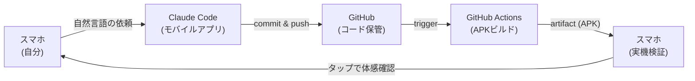

:::message
PCを開けない通勤電車の中で、Claude Code に修正を頼み、GitHub Actions で APK を作り、スマホに入れて動作確認する。FretInterval 開発で実際に回していた、**スマホ1台のAndroid個人開発フロー**をまとめます。
:::

この記事は、以下の FretInterval 開発記の続編で、「移動中にスマホで Claude Code 開発する仕組みを作った」セクションの実装ガイド版です。

https://zenn.dev/ykenkou001/articles/fret-interval-android-guitar-app

親記事は開発の「物語」、本記事は実際に運用してきた「仕組み」を書きます。

## 1. 結論：5ステップで回るフロー

PCを開かない日でも、Android アプリ開発は次の5ステップで前に進みます。

1. **スマホから Claude Code に依頼**：「ここを直して」と自然言語で頼む
2. **Claude Code が `claude/<topic>` ブランチに commit & push**：人がコードを書く工程は無い
3. **GitHub Actions が APK をビルド**：`branches: [main, 'claude/**']` で push 起点に自動実行
4. **スマホで artifact をダウンロード**：Chrome で GitHub を開いて zip を取得
5. **APK をインストールして実機確認**：触って気づいた点は、また 1. に戻して依頼

ポイントは、**「コードを書く環境」「ビルドする環境」「動作確認する環境」が全部別の場所にあって、自分はそれらを自然言語で繋いでいるだけ**ということです。PCを開く工程はどこにも入りません。

## 2. 責務分解：どこに PC が要らないか／要るか

このフローを支えているのは、開発の各責務をクラウド側に外出ししたことです。



責務ごとに整理するとこうなります。

| 責務 | 担当 | 必要な端末 |
|------|------|------------|
| 仕様の言語化 | 自分 | スマホで足りる |
| コード生成・修正 | Claude Code | スマホで依頼すれば、Claude側で実行 |
| Git 操作（commit / push） | Claude Code | 同上 |
| ビルド環境（JDK / Gradle / SDK） | GitHub Actions | クラウド側、自端末不要 |
| APK 配布 | Actions artifact | スマホでダウンロード可 |
| 実機での動作確認 | 自分 + スマホ | スマホそのもの |
| 署名つきリリース・Play 配信 | （別工程：今回のスコープ外） | PC・Play Console |

「PC でしかできない作業」を意識的にゼロにしています。署名つきの Play 配信ビルドはここから外しました。なくても自分用には困らないからです。

## 3. 構成要素①：スマホから Claude Code に依頼する

スマホから Claude Code に依頼するのに使っているのは、**Claude 公式モバイルアプリ**（iOS / Android）です。

このアプリは GitHub リポジトリと直接連携できるので、**依頼してから push が走るまで、人手で介在する操作はありません**。「ここを直して」と自然言語で頼むだけで、Claude Code 側でコード修正・commit・push が完結します。スマホ画面で git コマンドを叩いたり、PR を作る操作をしたりする必要はありません。

### 3.1 依頼スタイル

定型のプロンプトテンプレは使っていません。「@spec を見て」「@lessons を踏まえて」のような呪文的なプレフィックスを毎回付ける運用はしていなくて、その時直したいことを素直に書いて投げています。

依頼の粒度も、**1機能=1コミットを厳格には敷いていません**。スマホ画面で読み切れる範囲なら複数の修正を一度に投げることもあります。

その代わり、**同じ失敗が続いたとき** だけ、Claude のメモリや `tasks/lessons.md` に学習として書き残します。FretInterval の lessons.md には現在 13 項目のルールが溜まっていて、たとえばこういうものです。

| ルール | 踏んだ罠 |
|--------|---------|
| `onTap` ではなく `onPress` を使う（即時反応が必要な UI） | `detectTapGestures(onTap = ...)` は数百ms遅れて発火する |
| `@file:OptIn(ExperimentalFoundationApi::class)` をファイル先頭に付ける | 関数単位の `@OptIn` は内部ラムダに伝播しない |
| `fallbackToDestructiveMigration()` 禁止、Migration を必ず書く | フィールド追加でクラッシュ・ユーザーデータ消失 |
| `noteValue`(0-11) と MIDI 絶対値は別管理 | 全 E が同じオクターブで鳴っていた |
| `return@onPress` の代わりに `?.let { }` で early return する | suspend ラムダで `return@label` がコンパイルエラー |

最初からこのルールセットを設計したのではなく、**踏んでから言語化したもの**です。lessons.md 自体が、Claude Code との対話の副産物として育っています。

### 3.2 直らないときの対応

実機で動かして「これは違う」と感じたとき、私のやり方は単純です。

> **直っていない、と指摘して、直るまで繰り返す。**

Claude Code は同じ修正を別アプローチで試すのが上手いので、「これでまだ X が起きる」「Y がまだ反映されていない」と返すと、別の方針で直してきます。スマホ画面で長い diff を読み込まなくても、実機の挙動を返すだけでループが進みます。

ちなみに `git revert` を頼んで方針ごと打ち消す手もありますが、**私は普段これを使っていません**。「指摘して直させる」で大半は片付くからです。とはいえ revert を使う発想自体は良いと思っていて、迷走したときの選択肢として残しておく価値はあります。

## 4. 構成要素②：GitHub Actions で APK 自動ビルド

ビルド環境は GitHub Actions に外出ししています。`.github/workflows/build.yml` の中身は最小構成です。

```yaml
name: Build APK

on:
  push:
    branches: [main, 'claude/**']

jobs:
  build:
    runs-on: ubuntu-latest

    steps:
      - uses: actions/checkout@v4

      - name: Set up JDK 17
        uses: actions/setup-java@v4
        with:
          java-version: "17"
          distribution: temurin

      - name: Setup Gradle
        uses: gradle/actions/setup-gradle@v4

      - name: Build debug APK
        run: chmod +x ./gradlew && ./gradlew assembleDebug

      - name: Upload APK
        uses: actions/upload-artifact@v4
        with:
          name: FretInterval-debug
          path: app/build/outputs/apk/debug/app-debug.apk
```

### 4.1 `branches` に `claude/**` を入れる意味

ポイントは `branches: [main, 'claude/**']` の部分です。Claude Code が新しい修正を `claude/feat-something` のようなブランチに push したら、**main へマージする前に APK を試せる** ようにしてあります。

実運用では、`claude/**` ブランチで APK を確認 → 良ければ main へマージ、というリズムにしています。

### 4.2 debug ビルドに留めた理由（境界の引き方）

このワークフローは `assembleDebug` までで止めています。`assembleRelease` で署名つき APK を作って Play Console にアップロードする手順は **意図的に書いていません**。

理由は3つです。

- **自分用に使う限り、debug ビルドで困らない**：機能差は無い
- **署名鍵を Actions 上に置きたくない**：個人鍵の管理は手元 PC でやるほうが安全
- **Play 配信はスマホ1台フローの本質ではない**：配信に進む工程は別で切り離す

「自分用 PoC は debug まで、配信に進むときだけ別ワークフロー」という境界を引いておくと、スマホ1台フローがシンプルに保てます。

### 4.3 ビルドの追跡は Claude Code に任せる

artifact retention は **デフォルト（90日）のまま** で運用しています。期限を縮める設定はしていません。

ビルド成功・失敗の通知についても、**私自身は通知を受けに行く運用をしていません**。代わりに **Claude Code に CI/CD の追跡そのものを任せています**。

依頼が走ったあとは、Claude Code が Actions のログを見に行き、失敗していれば原因を特定して修正コミットを `claude/**` ブランチに push し直してくれます。私は通知も Actions タブも開かず、「直った？」と聞くだけで済む構成になっています。これが、スマホ1台フローのなかで一番楽になった部分でした。

実例として、CI を立ち上げた当日（2026/3/27）の commit ログを抜き出すとこうなります。

```text
8430f4b GitHub ActionsでAPK自動ビルド＆アップロードを追加        (自分)
7e463a8 CI: gradlewに実行権限を付与して修正                      (自分)
9afe0b5 CI: ギター音源wavをリポジトリに含めてビルド修正            (自分)
9edd7ab CI: claude/**ブランチでもビルドワークフローを実行するよう設定 (Claude)
```

最後の `9edd7ab` は **Claude が Author になっています**。CI 設定そのものを Claude が自分で書き換えて push したコミットです。最初に作った workflow は `branches: [main]` だけだったのですが、実運用してみると Claude が切る `claude/**` ブランチで APK が出ないと不便だ、という会話のあとに、Claude 自身が build.yml を編集して push しました。

Claude Code のコミット権限を絞らずに渡しているからこそ成立する運用ですが、CI の設定変更まで AI に任せられる、という体験は新鮮でした。

## 5. 構成要素③：スマホで APK を受け取って試す

ビルド完了後、スマホでやることはシンプルです。

### 5.1 Chrome で GitHub を開いて zip をダウンロード

私は **Chrome で GitHub を開いて、Actions の最新ランから artifact の zip を直接ダウンロード** しています。GitHub Mobile アプリ経由ではなく、ブラウザ経由です。

zip ファイル名は `FretInterval-debug.zip` のような形で、ダウンロードフォルダに落ちます。

### 5.2 zip を展開して APK をインストール

zip を展開すると `app-debug.apk` が出てくるので、それを開いてインストールします。Google Play 経由でないアプリのインストールには「不明なアプリのインストール」許可が必要ですが、これは Android 一般の作法なので、各自の端末でブラウザに対して権限を付与してください。一度許可すれば次回以降は不要です。

USB デバッグも開発者オプションも要りません。**自分の端末にだけ自分用 APK を入れるための最短経路** として整っています。

インストール後、アプリを起動して動作確認 → 気づいた点があれば、また §3 の Claude Code 依頼に戻ります。これで一周します。

## 6. ハマり所と打ち手

このフローは仕組みとしてはほぼ自動で回るのですが、立ち上げ時と運用時にいくつか詰まりました。実体験から、罠と回避策をまとめて書きます。

### 6.1 CI を立ち上げた初日に3連続でビルドが落ちた

§4.3 でも触れたように、CI を立ち上げた 2026/3/27 は同日中に3連続で修正コミットが入りました。

| commit | 詰まったこと |
|--------|------|
| 7e463a8 | `gradlew` に実行権限が無くて Actions 上で `Permission denied` |
| 9afe0b5 | ギター音源 wav を `.gitignore` で外していて、Actions 側にビルド時の素材が無かった |
| 9edd7ab | 初版 workflow が `branches: [main]` のみで、Claude が切る `claude/**` ブランチで APK が出なかった |

ローカル PC では `chmod` 済みの `gradlew` がそのまま動き、wav も手元にあるのでビルドが通っていました。**Actions に移して初めて、自分がローカル状態に依存していたことが露呈する** タイプの罠です。

立ち上げ初日にここを潰しておくと、以後は CI が安定して回ります。逆に、ここを Claude Code 任せでサクッと直せる体験こそが、CI/CD 追跡まで AI に任せる運用の説得力になりました（特に 9edd7ab は Claude 自身が直した実例です）。

### 6.2 テキストだと修正意図が伝わらないことがある

実機で触って「ここの挙動がなんか違う」と感じても、それを文字で正確に Claude に伝えるのは意外と難しいです。

- タップしてからの遅延感
- アニメーションの引っかかり
- 音の小さなズレ

こういう「体感で気持ち悪い」種類の話は、テキスト化した瞬間に解像度が落ちます。Claude は「タップ反応が悪い」とだけ伝えると別の場所を直してくることがあって、何が違うのかをもう一段具体化（ボタンを押した瞬間からの時間、起きる頻度、どの画面か）して投げ直す必要が出ます。

PC で diff を読みながら「ここのこの行のこの値を変えて」と書ける時と比べて、**体感ベースの依頼は往復が増える**のが、このフローのコストでした。

### 6.3 打ち手：デザイン面の修正は「スクショ＋手書き注釈」で渡す

§6.2 の対策として、**デザイン面の修正は、画面のスクショを撮って、ペンでフリーハンドの注釈を書いたり、テキスト注釈を重ねたりして Claude に渡すことが多くなりました**。

「このボタン、もっと右に寄せて」と書く代わりに、スクショに矢印を引いて「ここ→ここ」と描き込むほうが、はるかに早く正確に伝わります。Claude は画像を読み取って「このボタンの右マージンを増やす」「このカードの位置を変える」といった意図を汲んでくれるので、依頼の往復が減ります。

スマホは元々スクショと手書き注釈に強いデバイスです。**テキスト入力が苦手な状況を、スクショ入力で迂回する**のが、このフローでは現実的な打ち手でした。

### 6.4 スマホのテキスト入力が得意じゃない

そもそも、スマホで長文を打つこと自体が私には向いていません。フリック入力で長く正確に打つのは PC のキーボードよりだいぶ遅く、**「言語化のスピード」がボトルネックになる場面が出ます**。

頭の中では仕様が見えているのに、それを打ち込む手間で諦めて「あとで PC で書く」になってしまうことが、特に複雑な依頼では起こります。短くて単純な指示はスマホで十分回せますが、込み入った修正はやはり PC のほうが速いと感じます。

それでも、**限られた時間の中で、移動中に個人開発を前に進められる** こと自体が、私にとっては大きなアドバンテージです。スマホ入力の遅さというハンデを差し引いても、通勤や待ち時間に commit と APK が積み上がっていく感覚は、PC 前に座って書ける時間が少ない個人開発者にとって、それだけで十分に価値があります。

このフローの本質は「PC を一切使わない」ではなく、**「PC を開けない時間でも開発を止めない」** という点にあると、運用してみて気づきました。

## 7. 効果と限界

### 効果

- **PC を開かない日でも開発が前に進む**：移動時間・休憩時間が直接アプリの進捗になる
- **CI/CDの追跡まで Claude Code に任せられる**：失敗ビルドを自動で直して push し直してくれるので、私は通知も Actions タブも見に行かなくて済む
- **書き手・ビルド環境・検証端末が分離されているので並行性が高い**：依頼と確認を非同期で挟める

### 限界

- **UI の細かい体感調整は実機タッチが必要**：`onTap` の遅延のような話は、実機で触らないと気づけません
- **テキストでの意図伝達に往復コストがかかる**（§6.2、対策は §6.3）
- **込み入った依頼はスマホ入力がボトルネックになる**（§6.4）
- **署名つきリリースは別工程**：Play 配信したくなった瞬間、PC を開く必要があります

## 8. まとめと続編予告

「PC を開かずに Android アプリを育てる」は、Claude Code 単体では実現できません。**Claude Code（モバイルアプリのGitHub連携） × CI/CD 追跡まで任せる運用** が揃ってはじめて、移動時間が直接開発の時間に変わります。

| 要素 | 役割 |
|------|------|
| Claude Code（モバイルアプリ） | 依頼の入口・コード生成・commit & push・**CI/CD追跡と自動修復** |
| GitHub | 共有ストレージ・ブランチ管理 |
| GitHub Actions | ビルド環境（claude/** で APK を出す） |
| スマホ（Chrome） | artifact 取得・実機検証 |

それぞれの責務を明確に分けると、PC が無くても回り続けます。逆に、自分の手元での操作を増やすほど、フロー全体が PC 待ちになって止まります。**「自分が今いる場所でできることだけに責務を絞る」** のが、このフローの設計の核心でした。

### 関連記事

**親記事：このフローは Android 向けギター練習アプリ FretInterval の運用知見ベースです。アプリ自体の開発記はこちら。**

https://zenn.dev/ykenkou001/articles/fret-interval-android-guitar-app

**同じ著者による別ドメインの越境個人開発記：規制対応SaaS（CLO支援アプリ）をMCP＋Next.jsで個人開発した話。**

https://zenn.dev/ykenkou001/articles/clo-logistics-decision-support

**設計編：上記CLOアプリの設計を3回作り直した経験から抽出した、MCPファースト設計の3原則。**

https://zenn.dev/ykenkou001/articles/mcp-first-regulatory-saas

### 続編予告

スマホ1台で完結させるための **「Claude Code への依頼の仕方そのもの」** を深掘りした続編を予定しています。

- 「Kotlin 未経験で Android アプリを Claude Code に書かせるためのプロンプト設計」（仕様書の書き方・三者設計討議・lessons.md の運用）

PC を開かなくても回るフローのもう半分は、**プロンプト側の設計** にあります。書けたらまた共有します。
