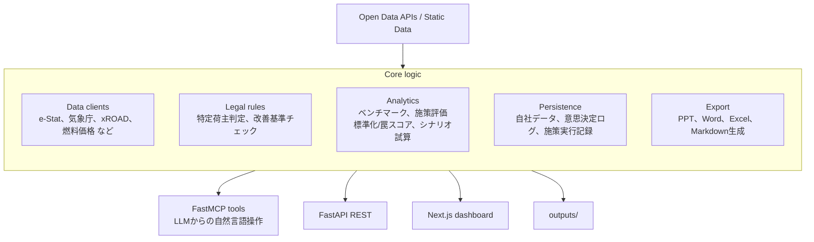
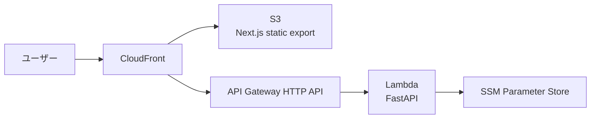

:::message
規制対応・業務アプリを作るエンジニア向けに、**CLO（物流統括管理者）支援PoC「Logi-Intel Dashboard」** を個人開発しています。中核ロジックの上に **12個のMCPツール**、Next.js ダッシュボード、FastAPI REST、4形式の成果物（PPT / Word / Excel / Markdown）一括生成を載せた構成で、Claude / ChatGPT / Gemini から自然言語でも操作できます。

法人プロダクトではなく、ひとりで作っているPoCです。CLO担当者・営業企画・社内説明向けのおすすめ確認順は、アプリ内の操作ガイドにまとめています。
:::


*トップ画面。CLO中長期計画の策定支援を、データ・施策評価・法令ロジックの3層から構成。*

開発用URL: https://d1zei8qivkf3cr.cloudfront.net/

:::message alert
開発中のPoCのため、予告なく停止・変更する可能性があります。実在企業の機密データは入力しないでください。法令上の手続や提出判断は、必ず公式資料を確認してください。
:::

この記事ではまず技術構成（アーキテクチャ・MCP・成果物生成・AWS）を説明し、後半でアプリの機能と規制の背景に触れます。エンジニア読者と物流・CLO担当者の両方に届くように整理しました。

## 全体アーキテクチャ：1つの中核ロジックに3つの入口

最初に技術構成から。アーキテクチャは「分析・法令判定・成果物生成の中核ロジック」を中心にして、Web画面・REST・MCPの3つの入口を持つ形にしています。



判断ロジックをMCP・REST・Web画面のそれぞれに散らさないことが、設計上の最大の原則でした。施策評価、法令判定、成果物生成のロジックは中核に集約し、MCP/REST/Webはそこへ到達する薄い入口にしています。

出口が変わっても、CLO支援のロジックと成果物の品質は同じであるべきです。Claude / ChatGPT / Gemini / AIコーディングツールのようなクライアントから自然言語で使う人もいれば、Webダッシュボードから触る人もいる。どの入口から入っても、同じ判断ロジックと同じ成果物に到達できる構造にしたいと考えています。

なお、この「中核ロジック + 3つの入口」構造を、規制対応・コンプラ系の業務アプリ全般に通用する設計論として整理した記事を別途書きました。LLM時代の業務アプリ設計のパターンに興味がある方は、こちらもどうぞ。

https://zenn.dev/ykenkou001/articles/mcp-first-regulatory-saas

## なぜMCPサーバーを作ったのか

このアプリでは、Web画面だけでなくMCPサーバーも作っています。

MCPを使うと、Claude / ChatGPT / Gemini / AIコーディングツールのようなクライアントから、自然言語でCLO支援機能を呼び出せます。例えば、こんな使い方を想定しています。

```text
sample_manufacturing_01 の中長期計画ドラフトを作って。
施策候補のTop 3と、選ばなかった施策の理由も出して。
社内説明向けのPPTと、根拠数値を追えるExcelも生成して。
```

このときLLMは、単に文章を生成するのではなく、MCPツールを通じて中核ロジックを呼び出します。

主なMCPツールは、CLO支援の流れに合わせて `logi_clo_*` に統一し、12個に整理しました。

| MCPツール | 役割 |
| --- | --- |
| `logi_clo_eligibility` | 特定荷主などの該当区分を判定する |
| `logi_clo_benchmark_position` | 業界・地域ベンチマークを見る |
| `logi_clo_driver_gap` | 地域別のドライバー需給ギャップを見る |
| `logi_clo_measure_eval` | 施策を評価し、優先順位を出す |
| `logi_clo_industry_package` | 業種別CLO標準パッケージを見る |
| `logi_clo_standardization_score` | 自社の業種別標準パッケージへの準拠度を見る |
| `logi_clo_waste_traps` | 効果が出ていない施策を、データ不足や季節性などを考慮して検出する |
| `logi_clo_today_decisions` | 今日見るべき判断カードを出す |
| `logi_clo_scenario_sim` | 燃料価格や需要変動のストレスをかける |
| `logi_clo_financial_translate` | 物流KPIを経営指標へ翻訳する |
| `logi_clo_plan_draft` | PPT、Word、Excel、Markdownを一括生成する |
| `logi_clo_submission_validate` | 提出前の整合性を検証する |

MCPを作ってよかった点は2つあります。

ひとつは、**プロダクトの使い方を早く試せること**。Web UIを作り込む前でも、LLMに「この会社なら何から着手すべきか」と聞き、内部では実装済みの分析ロジックを呼び出せます。画面より先に、ロジックの妥当性を検証できる順番になりました。

もうひとつは、**生成物に到達したあと、根拠・前提・代替案・リスクを会話で深掘りできること**。画面操作だけだと、利用者は用意されたボタンやフォームの範囲でしか探索できません。MCP経由なら、PPTやExcelを生成したあとに「この施策の根拠は何か」「燃料価格が上がった場合はどうなるか」「この施策を外した理由を詳しく知りたい」といった疑問を、会話の流れで掘り下げられます。CLO支援のように「一回の分析で終わらず、関係者と議論しながら計画を詰める」用途とは相性がよいと感じています。

## 一番苦労したのは成果物生成（PPT / Word / Excel / Markdown）

このアプリは、最終的に次のような成果物を出します。

- 社内説明向けPowerPoint
- 様式に沿ったWordドラフト
- 根拠数値と出典を追えるExcel
- 社内共有やレビューに使えるMarkdown


*計画書ドラフト統合生成。1クリックでPPT/Word（様式第3別紙）/Excel/Markdownを一括生成し、統合サマリーや提出準備チェックリストまで提示する。*

実装上は、成果物生成の責務をひとつの層に集約しています。画面やAPIは変わっても、成果物の品質は同じであるべきだからです。CLO支援の価値は、分析ロジックそのものだけでなく、社内でレビューされ、説明され、修正され、提出されるところまで届いて初めて成立します。

そして作っていて一番手間がかかったのも、ここでした。

**PowerPoint**: Web画面で見ればそれなりに見える情報でも、PPTに出すと急に粗が出ます。文字がはみ出す、表が読みにくい、KPIカードの余白が詰まる、ページごとの情報密度が揃わない。

**Excel**: 単に数値を並べるだけではレビュー資料になりません。読み手が最初に見るサマリー、根拠を確認する詳細表、出典を追うシートを分ける必要があります。

**Word**: 様式に沿う必要があるため、見た目の自由度よりも、必要項目が抜けていないこと、法令区分に応じた文言が崩れないことが重要になります。

LLMを使ったアプリ開発では、画面や文章の生成に目が行きがちです。でもCLO支援の文脈では、最後に出てくるPPT・Excel・Wordの品質がそのままプロダクトの信頼性になります。ここは思った以上に地味で、かつ重要でした。

## AWS構成：PoCの運用コストを抑えるサーバーレス構成

開発用には、次のURLでPoC環境を動かしています。

https://d1zei8qivkf3cr.cloudfront.net/

構成は、PoCとして運用コストを抑えるため、CloudFront、S3、API Gateway、Lambdaを中心にしています。



最初はECSやALBも検討しましたが、開発段階では常時稼働のコストを増やすより、静的配信とサーバーレスで十分だと判断しました。

CI/CDはGitHub Actionsで設定しています。Pull RequestとmainへのpushでRuff、pytest、ESLint、TypeScript型チェック、Next.js buildを実行し、最低限の品質ゲートを通すようにしました。

デプロイはWebとAPIでworkflowを分けています。WebはS3へ静的ファイルを同期してCloudFrontを無効化し、APIはLambdaを更新します。AWS認証はOIDCを使い、長期アクセスキーを置かない構成にしています。

運用面では、CloudWatch Logsの保管期間、Lambdaエラー数、p95レイテンシ、月額BudgetアラートもTerraformに入れています。PoCでも、止まったことやコストが膨らんだことに気づけない構成にはしないようにしました。

## 何を支援するアプリか

ここからプロダクト視点に戻ります。CLOは、物流現場だけを見る役職ではありません。

営業が短納期を求める。生産が効率のよいロットを優先する。調達や在庫管理がそれぞれ別の制約を持つ。そうした部門ごとの最適化が、物流にしわ寄せされる。CLOの仕事は、この構造を経営判断として調整することです。

つまりCLO支援アプリに求められるのは、データを見せることではなく、**部門間・社外・経営層との会話に使える判断材料を作ること**です。Logi-Intel Dashboardでは、主に次の機能を想定しています。

| 機能 | 目的 |
| --- | --- |
| 適用判定 | 自社が特定第一種荷主・特定第二種荷主・特定連鎖化事業者などに該当するかを確認する |
| 入力テンプレート生成 | 自社データ入力用のExcelフォーマットをダウンロードし、記入後に分析へ使えるようにする |
| 業界ベンチマーク | 自社の業種・地域を、e-Statなどの公的データや標準係数と比較する |
| ドライバー需給ギャップ | 公的統計をもとに地域別の物流制約を把握する |
| 業種別CLO標準パッケージ | 製造業、卸売業、小売業、連鎖化事業者ごとのKPI、施策、会議体、データ項目を整理する |
| 数値目標提案 | 積載率、CO2、物流コストなどの改善目標を提案する |
| 施策評価 | 施策をROI、実装可能性、法令適合度、補助金観点で評価し、優先順位を決める |
| 標準化スコア・罠スコア | 業種別の標準パッケージへの準拠度や、効果が出ていない施策の見落としを確認する |
| デイリーコックピット | CLOが今日判断すべき未達KPI、放置リスク、施策候補を絞って表示する |
| シナリオ試算 | 燃料価格や需要変動などのストレスをかけて計画の強さを見る |
| 財務翻訳 | 物流KPIを社内説明に使える財務インパクトへ翻訳する |
| 成果物生成 | PowerPoint、Word、Excel、Markdownを一括生成する |
| 提出前検証 | 提出用様式に必要な記載や整合性を確認する |

例えば「業種別CLO標準パッケージ」では、製造業・卸売業・小売業・連鎖化事業者ごとに、KPI・施策・会議体・レポート・データ項目をまとめて確認できます。


*製造業の標準パッケージ。KPI 5件・施策 6件・会議 3件・レポート 3件・データ項目 3件を「標準型」として保持し、個社差分はOverride管理する設計。*

実運用イメージとしては、CLOが朝に開く「デイリーコックピット」で、未達KPI・放置リスク・今週決める施策の3件を1画面に集約しています。


*デイリーコックピット。重大対応／法令準拠リスク／今週決める施策を3カードに整理し、緊急度・経営インパクト・自信度・想定反論まで添えて意思決定ログに記録。*

特に重視しているのは、施策の優先順位付けです。CLOが社内で聞かれるのは「なぜこの施策をやるのか」だけではなく、「**なぜモーダルシフトではないのか**」「**なぜ共同配送ではないのか**」「**なぜバース予約から始めるのか**」といった選外理由です。

そこで施策評価では、候補施策を次の観点で見ています。

| 評価軸 | 見ていること |
| --- | --- |
| ROI | 投資額に対して、どの程度の効果が期待できるか |
| 実装可能性 | 拠点数、車両、協力会社、社内体制に対して実行できるか |
| 法令適合度 | 中長期計画に必要な項目と結びついているか |
| 補助金・認定制度 | 外部制度と結びつけられる可能性があるか |


*施策評価エンジンの出力。Top 3の選定根拠（ROI/実装可能性/法令適合度/補助金）に加え、不採用候補（Bottom 3）の選外理由まで提示する。*

ここで重要なのは、スコアを高く見せることではなく、むしろ「**この会社には今は難しい**」と言えることです。共同配送は魅力的でも、相手先候補やルート条件がなければ絵に描いた餅になります。高度な倉庫自動化も、投資余力や現場標準化がなければ先にやるべきではないかもしれません。

さらに、施策を実行したあとの記録も追えるようにしました。どの施策を、いつ始め、いくら投資し、期待効果と実績効果がどう違ったのかを保存し、次回の評価に使います。CLO支援は初回計画を作って終わりではなく、施策を見直し続ける運用が必要だからです。

なお、分析以前に「企業がどんなデータを準備すればよいか」を明確にする必要があるため、いきなり分析画面を出すのではなく、入力用Excelテンプレートをダウンロードし、会社情報・拠点・取扱貨物量・積載率・荷待ち時間などを整理してから取り込める導線を用意しています。CLO候補者や物流・SCM担当者が最初に困るのは「どのデータを、どの粒度で、誰に依頼すればよいか」だからです。

## 規制の背景：2026年度に何が始まるのか

ここまで読んで「そもそもCLOって何が義務化されるのか」が気になった方向けに、規制の背景を整理します。

2026年度施行予定の規制的措置では、一定規模以上の荷主や連鎖化事業者などが特定事業者として指定されると、中長期計画の作成や定期報告などが義務付けられます。さらに、特定荷主・特定連鎖化事業者には、CLO（物流統括管理者）の選任も求められます。

この制度の重さは、「物流部門が書類を作ること」ではなく、「**物流を経営判断として扱うこと**」にあります。

CLOが機能すれば、物流は単なるコスト削減対象ではなくなります。荷待ち時間を減らし、積載率を上げ、部門間の無理な調整をほどくことで、限られた輸送力を事業成長に振り向けられるようになります。物流の効率化は、守りの法対応であると同時に、企業のビジネスを前に進める攻めの経営テーマでもあります。

経済産業省のCLO取組事例集を読むと、先進企業の取り組みも同じ方向を向いていました。

- SUBARUは、部門に分散していた物流費を全社で把握できるようにした
- J-オイルミルズは、物流ハンドブックを作って他部門への説明に使った
- 日清食品は、異業種・同業他社との共同輸送を進めた
- 日本アクセスは、待機時間の可視化と営業部門を巻き込んだ改善に取り組んだ
- サンゲツは、積載効率だけでなく荷役負荷の低減も含めて判断した

CLOの選任が義務となる企業にとっても、目指す方向は同じです。物流を部門ごとの個別最適のまま扱うのではなく、全社の経営効率化につながるテーマとして整理し、どこから着手すべきかを判断できるようにする必要があります。

特定荷主や特定連鎖化事業者に該当する場合、たとえば次のような対応が必要になります。

- 指定に関する届出を行う
- 中長期計画を作成する
- 物流統括管理者であるCLOを選任する
- 定期報告を行う
- 貨物重量の増加、荷待ち時間の短縮、荷役等時間の短縮などの取り組みを整理する
- 実施時期や目標を示す
- 判断基準の遵守状況や、荷待ち・荷役等時間の状況を継続的に報告する

つまりCLO支援で必要なのは、法定様式を作るだけではありません。**自社がどの区分に該当するのか、どのデータを集めるべきか、どの施策を優先すべきか、社内や取引先と何を合意すべきかを、継続的に判断できる状態にすること**です。このアプリで入力テンプレート、施策評価、成果物生成、出典管理をまとめて扱いたい理由もそこにあります。

ちなみに私自身は物流システムの開発に携わっており、課題として身近でもありました。物流DXツールはありますが、CLOが「どの施策を優先すべきか」を決めるところまで支援するものは、少なくとも身近には見えていません。LLMを使ったアプリ開発の成果を、もう少し実務に近い形で展開したかったというのも、作り始めた動機のひとつです。

## 作ってわかった3つのこと

### 1. CLO支援は「法対応アプリ」だけでは弱い

法定様式を埋めるだけなら、入力フォームとWord出力で足ります。

でも、CLOの本当の難しさは、**部門間の利害調整と投資判断**です。物流部門だけが頑張っても、営業が短納期を変えない、生産がロットを変えない、取引先と調整できない、という状態では改善は進みません。

CLOが活躍する会社では、物流改善は「罰則を避けるための対応」に留まりません。営業が売りやすくなり、調達や生産の計画精度が上がり、配送制約を前提にした現実的な成長戦略を描けるようになります。物流の効率化を、ビジネスを止めないための防衛策ではなく、ビジネスを伸ばすための基盤として扱うことが重要だと考えています。

### 2. 物流DXは、非効率をデジタル化すると逆に危ない

既存の非効率な運用をそのままIT化すると、「**デジタル化された非効率**」になります。

たとえば、個別最適の納品条件を維持したままシステムだけ入れると、非効率が高速に処理されるだけです。CLOに必要なのは、業務を標準化し、全体最適に寄せる判断です。

### 3. 出典と説明責任は、機能の一部

物流改善の数値は、社内説明や関係部門との合意形成で必ず突っ込まれます。

「そのドライバー不足の数字はどこから来たのか」
「CO2削減量の係数は何か」
「この施策の効果は楽観的すぎないか」

そのため、出典URL、統計表ID、告示・法令との対応を追えるようにすることは、単なる親切機能ではありません。CLOが説明責任を果たすための本体機能です。

## これからやること

まだまだ開発段階なので、今後は「実務で使える」と言い切る前に、いくつかの仮説を検証していきたいです。

特に面白そうだと思っているのは、CLO候補者や物流・SCM担当者、営業・企画の人に触ってもらったときに、次のような検証ができるかどうかです。

- 入力項目は、現実の企業が準備できる粒度になっているか
- 入力テンプレートは、物流・SCM担当者が社内で記入依頼しやすい形になっているか
- 施策推薦は、現場感とズレていないか
- 「選ばなかった施策の理由」は、社内説明や関係部門との合意形成に使えるか
- 業種別パッケージ、標準化スコア、罠スコアは、CLOの継続運用に使える粒度になっているか
- PowerPointやWordドラフトは、社内説明や提出準備のたたき台として使えるか
- S&OP、共同配送、取引先調整のようなテーマまで広げたときに、どの機能が本当に価値を持つか

機能を増やすだけならいくらでもできますが、CLO支援として重要なのは、**現場と経営の会話が前に進むこと**です。その意味で、単なる分析結果ではなく、会議や説明の場で使える判断材料になっているかを確かめていきたいです。

## エンジニア視点の調査・実装ログをnoteにも書きました

本記事はエンジニア向けに、技術構成・MCP・成果物生成の話を中心にまとめました。一方で、CLO義務化を見据えてこのアプリを作るに至った動機、業務で物流システム開発に関わってきた立場からの課題観、公的データでどこまで支援できるかの判断、そして作って初めて分かった限界を、別の切り口で整理した記録もあります。

技術詳細より「なぜ作ったか／どう調べたか／何が解けて何が解けなかったか」に関心がある方は、こちらもどうぞ。

▶ note記事: [CLO義務化を見据えて支援アプリを作った、物流システムエンジニアの調査と実装ログ](https://note.com/open_hound6976/n/nec3134b15596)

## まとめ

CLO選任義務を含む物流効率化法の規制的措置は、単に物流担当者の仕事が増える話ではなく、物流をコスト削減の対象から、経営の持続可能性を支える意思決定領域へ移す制度変更だと思っています。

技術的には、Python・FastAPI・MCP・Next.js・AWSを組み合わせた素直な構成です。ただし、価値の中心はそこではありません。**法令、公的データ、社内データ、施策評価、財務翻訳、成果物生成をひとつなぎにし、CLOが施策の優先順位を決められるようにすること**。そこに、CLO支援アプリとしての面白さがあります。

開発URLは下記です。触ってみて気づいた点や、こういう企業ならこう使いたいという声があれば、ぜひ教えてください。

https://d1zei8qivkf3cr.cloudfront.net/

## 参考

- 「物流効率化法」理解促進ポータルサイト: https://www.revised-logistics-act-portal.mlit.go.jp/
- 物流統括管理者（CLO）の選任: https://www.revised-logistics-act-portal.mlit.go.jp/clo/
- 中長期的な計画の作成: https://www.revised-logistics-act-portal.mlit.go.jp/planning/
- 定期報告: https://www.revised-logistics-act-portal.mlit.go.jp/regular-report/
- 経済産業省 物流効率化法について: https://www.meti.go.jp/policy/economy/distribution/butsuryu-kouritsuka.html
- CLO取組事例集 - 物流改革の実践と成果: https://www.meti.go.jp/policy/economy/distribution/CLO_collection_of_cases.pdf
