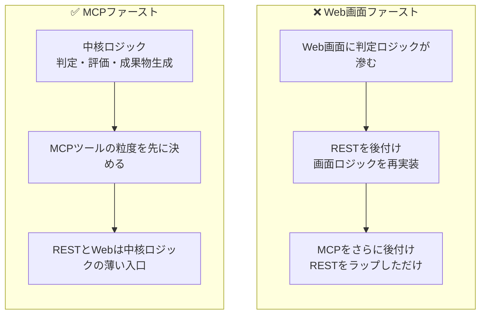
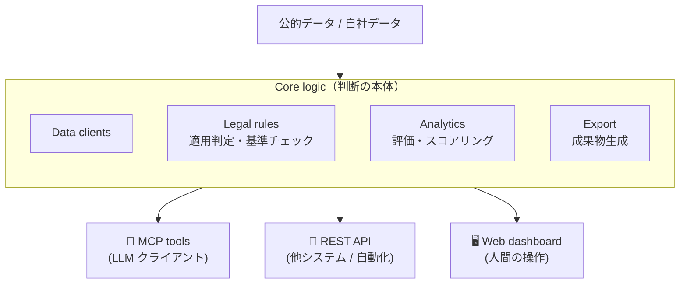
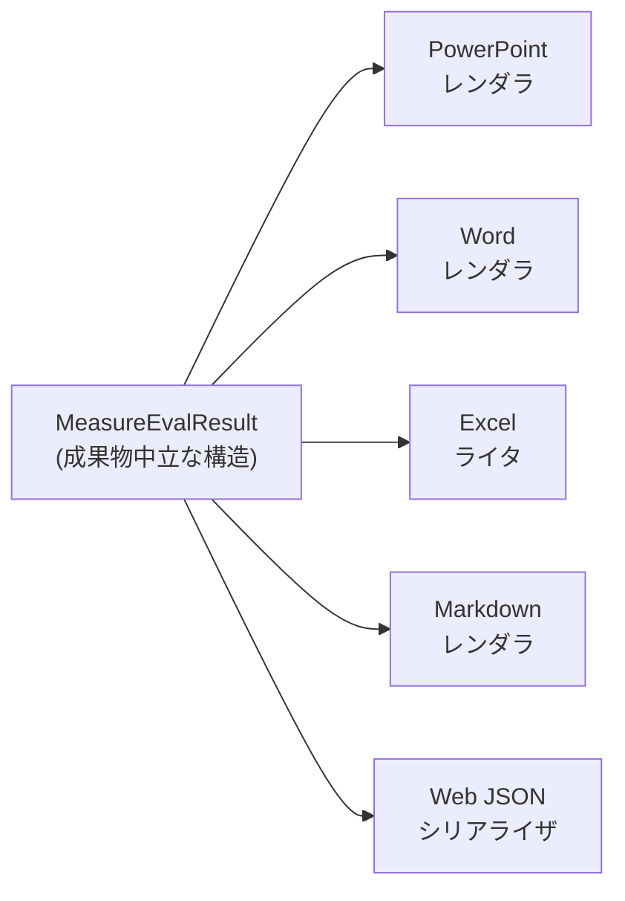

CLO（物流統括管理者）の意思決定支援アプリを個人開発する中で、設計を3回作り直しました。原因は、画面でもAPIでもなく、「LLMから呼ばれる」ことを最初の設計制約に入れていなかったことです。

LLMから呼ばれることを前提にすると、業務アプリの設計順序はひっくり返ります。先にWeb画面を作ってからAPIを足し、最後にMCPサーバーを後付けする──という普通の順序ではうまくいきません。

3回作り直した結果、**MCPファースト**で組むと判断ロジックが腐らないと分かってきました。この記事では、その過程で見えた3つの原則をまとめます。

:::message
この記事では、法対応・コンプライアンス・GRC・ESGのように、判断理由や出典を後から説明する必要があるアプリを、まとめて「**説明責任の重い業務アプリ**」と呼びます。以降、単に「業務アプリ」と書く場合もこの意味です。FastMCPやMCP対応サーバーを実装しているバックエンドエンジニア・アーキテクトが想定読者です。
:::

## 結論：3つの原則

先にまとめます。

| 原則 | 一言で言うと |
| --- | --- |
| 1. 入口層は薄く保つ | 判断ロジックを「画面」「REST」「MCP」のどこにも書かない。中核ロジックに集約する |
| 2. 出力形式は最初から多重化する | 説明責任の重い業務では「画面で見る」より「PPT/Word/Excel/Markdownで持ち帰る」方が本体 |
| 3. 出典・根拠・代替案を返り値に含める | スコアだけ返してはいけない。LLMが説明責任を果たせるよう、構造化して返す |

もちろん、実運用ではこれ以外にも、認証・認可、監査ログ、ツールスキーマのバージョニング、副作用や冪等性の扱いも必要です。ただ、MCPファーストで設計したときに**最初に崩れやすかったのは「入口」「成果物」「返り値」の3点**でした。この記事ではそのインターフェース設計に絞って整理します。

順に説明します。

## なぜ「MCPファースト」なのか

ここ数年、業務アプリの利用者は人間だけではなくなりました。Claude Desktop、ChatGPT、Gemini、Claude Code、Cursorといったクライアントが、ユーザーの代わりにアプリのAPIを叩く時代に入っています。

特に**説明責任の重い業務アプリ**は、LLM経由の操作と相性が良い領域です。理由は3つあります。

1. **問い合わせが自然言語に向く**: 「うちの会社、特定荷主に該当する？」「中長期計画のドラフト作って」のような問い合わせは、画面のフォームに落とし込みにくい。LLMの方が向いています。
2. **成果物の生成が前提**: 説明責任の重い業務の最終アウトプットは、画面ではなく「説明資料」「提出書類」「監査ログ」です。LLMが構造化された結果を会話で深掘りしながら、最終資料に落とす流れが自然です。
3. **判断の根拠が常に問われる**: 「なぜこの施策？」「なぜそれを採用しなかった？」が頻繁に飛んでくる領域なので、LLMが返答できる粒度の情報を、ツールが返せる必要があります。

ところが、Web画面ファーストで設計してしまうと、判断ロジックが画面の中に滲み出します。「このボタンを押したらこの判定をする」「この画面でだけこの注釈を出す」といった暗黙のロジックが画面層に溜まり、後からMCPを足したときに「画面では出ているはずの注釈がMCPからは出てこない」事故が起きます。

だから、設計順序をひっくり返します。**最初にMCPツールの粒度を決めて、その上にREST、その上にWeb画面を載せる**。これがMCPファースト設計です。

ここでいう「MCPファースト」は、**判断ロジックをMCPサーバーに書く**という意味ではありません。最初に「LLMからどの粒度で呼ばれ、どんな返り値が必要か」を設計制約として決め、その制約を満たす中核ロジックを作る、という意味です。そのうえでMCP/REST/Webは、同じ中核ロジックへ到達する薄い入口にします。



## 中核ロジック1つから、LLM／API／Webへ展開する

ここがこの記事で一番伝えたい設計です。

判断ロジック（適用判定、施策評価、法令適合度チェック、成果物生成）を**中核ロジック層**に集約し、その上に**MCP・REST・Web**の3つの入口を生やします。3つの入口は、すべて同じ中核ロジックを呼ぶだけの薄い変換器です。



この構造の効きどころは、**1つのロジックを書くだけで、3種類のクライアントに同時に展開できる**ことです。

| 入口 | 想定クライアント | 何ができるか |
| --- | --- | --- |
| **MCP** | Claude Desktop / ChatGPT / Gemini / Claude Code / Cursor | 自然言語で判定・評価・成果物生成。会話で深掘りも可能 |
| **REST** | 他システム連携、CI/CD、自動化スクリプト、外部画面 | 既存の業務フローやワークフロー基盤に組み込む |
| **Web** | エンドユーザー（ブラウザ操作） | 慣れた画面操作で、定型業務をこなす |

判定ロジックは中核に1箇所だけ存在し、入口層はパラメータの整形と結果の整形しかしません。

たとえば「この会社は特定荷主に該当するか」という判定は、Web画面のフォーム送信からも、RESTの`POST /eligibility`からも、MCPの`logi_clo_eligibility`ツールからも、**同じ関数を呼びます**。

この設計が効くのは、次のような場面です。

- **LLM対応を後から付け足したくなったとき**: 中核ロジックは既に書かれているので、MCPツールを薄く生やすだけで済む。判定ロジックの再実装や、画面層からの呼び出しといった奇妙な構造は発生しない
- **画面リニューアルが入ったとき**: Webを書き換えても、MCPツールとREST APIは無傷。中核ロジックも触らずに済む
- **他社・他システムから連携したいと言われたとき**: REST APIを開けるだけで対応できる。MCPもWebも変更不要
- **新しいLLMクライアントが普及したとき**: MCPの仕様に従っていれば、Claude / ChatGPT / Gemini / 次のクライアントすべてから同じツールが使われる

つまり、**「LLM経由で使われるアプリ」「他システムから使われるAPI」「人間が画面で使うダッシュボード」を、別々に作る必要がなくなります**。1つの中核ロジックから、3つの世界に同時に展開できる構造です。

そして、この「**3つの入口を等距離に置く**」設計を成立させるための原則が、次の3つです。

## 原則1: 入口層は薄く、判断ロジックを入口に依存させない

最初の原則は、上の「中核ロジック + 3つの入口」を成立させるための**最低条件**です。

3つの入口それぞれに判定ロジックを書いてしまうと、片方の入口で出ているロジックがもう片方では出ない事故が必ず起きます。判断ロジックは中核に1箇所だけ。入口層に判定の中身は書かない。これを徹底します。

### アンチパターン: 画面の中に法令判定が紛れる

ありがちな失敗は、Web画面のコンポーネントの中に法令判定が紛れることです。

```typescript
// アンチパターン: Reactコンポーネントの中に判定ロジックが住んでいる
function EligibilityForm() {
  const handleSubmit = (data) => {
    // ❌ ここに判定ロジックを書いてしまう
    if (data.cargoVolume >= 9_000_000 && data.industry === "manufacturing") {
      setResult({ category: "特定第一種荷主", reason: "..." });
    }
    // ...
  };
}
```

これをやると、後からMCPツールを生やしたときに、ロジックを書き直すか、画面層を呼び出す変な構造を作るかの二択になります。どちらも崩壊します。

### パターン: MCPツールの粒度を先に決めて、内部実装に降りていく

MCPファーストでは、最初にMCPツールの「粒度と返り値」を決めます。

```python
# まずMCPツールのインターフェースを決める
@mcp.tool()
def logi_clo_eligibility(company_id: str) -> EligibilityResult:
    """特定荷主等の該当区分を判定する。"""
    return eligibility_service.evaluate(company_id)

# 中核ロジックは入口層を知らない
class EligibilityService:
    def evaluate(self, company_id: str) -> EligibilityResult:
        company = self.repo.get(company_id)
        return self.rules.classify(company)
```

`EligibilityResult` はPydanticモデルとして定義し、判定区分・理由・根拠・参照条文・前提条件をJSON Schemaに落ちる形にしておきます。MCPツールの返り値は、LLMが解釈できる構造として宣言されている必要があるからです。

REST APIもWeb画面も、`eligibility_service.evaluate()`を呼ぶだけです。入口層に判断は書かれません。

この設計をするだけで、Claude / ChatGPT / Gemini / AIコーディングツール / 普通のブラウザ──どこから来ても、同じ判定結果が返る状態になります。

## 原則2: 出力形式は最初から多重化する

次の原則は、説明責任の重い業務アプリ特有の話です。

普通の業務アプリなら、画面で結果を見せて終わりです。検索結果、ダッシュボード、グラフ。それで成立します。

ところが説明責任の重い業務アプリは違います。最終アウトプットは「画面」ではなく「**持ち帰り資料**」です。

| 出力形式 | 用途 |
| --- | --- |
| PowerPoint | 社内説明、経営会議、取引先説明 |
| Word | 法令様式に沿った提出書類のドラフト |
| Excel | 根拠数値・出典を追える詳細データ、レビュー資料 |
| Markdown | 社内Wiki、レビュー、Pull Requestへの貼り付け |
| JSON | 他システム連携、監査ログ |

LLMから「この会社の中長期計画ドラフトを作って」と頼まれたとき、テキストで返すだけでは足りません。社内で説明するためのPPT、提出様式に合うWord、根拠を追えるExcel──これらが同時に出てくる必要があります。

### 出力形式の多重化を後付けすると痛い

これも、後から足そうとすると非常に痛いポイントです。

理由は、**出力形式ごとに「載せられる情報量」と「向いている見せ方」が違う**からです。

- **PowerPoint**: Web画面で見ればそれなりに見える情報も、PPTに載せると粗が出る。文字がはみ出す、表が読みにくい、KPIカードの余白が詰まる、ページごとの情報密度が揃わない
- **Excel**: 単に数値を並べるだけではレビュー資料にならない。サマリーシート、詳細表、出典シートの3層構造が必要
- **Word**: 様式に沿う必要があるため、見た目の自由度よりも、必要項目の抜け漏れチェックが重要
- **Markdown**: 法令番号や数値の出典をハイパーリンクで埋め込めるかが要点

これらを「画面が完成した後で」追加しようとすると、データ構造が画面表示用に最適化されすぎていて、文書生成側で破綻します。

### パターン: 中核ロジックは「成果物中立」なデータ構造を返す

中核ロジックは、画面・PPT・Excelのどれにも変換できる中立的なデータ構造で結果を返します。

```python
# ❌ 画面表示用に最適化された構造
class MeasureEvalForUI:
    title: str
    badge_color: str  # UI都合の情報が混ざる
    score_label: str  # "★3" のような表示文字列
    chart_data: list[dict]  # 画面のChartコンポーネント用

# ✅ 成果物中立な構造
class MeasureEvalResult:
    measure_id: str
    roi: ROIBreakdown          # 投資額・期待効果・回収期間
    feasibility: FeasibilityScore
    legal_alignment: LegalAlignmentScore
    subsidy_eligibility: SubsidyMatch
    rationale: list[str]        # 採用理由
    rejected_reasons: list[str] # 不採用理由（後述）
    sources: list[Source]       # 出典（後述）
```

このデータ構造ひとつから、PPT用レンダラ、Excel用ライタ、Web用シリアライザ、MCP返り値、すべてが派生します。**Export層は「中核ロジックの結果 → 各形式」の変換器**として独立させます。



LLMから「中長期計画のドラフトを作って。社内説明向けPPTと、根拠数値を追えるExcelも生成して」と頼まれたとき、MCPツールは成果物を生成し、返り値には `artifact_id`、ファイル種別、保存先URI、出典サマリ、再生成に必要な条件を構造化して返します。バイナリそのものをツールの返り値に詰めるのではなく、**ファイルはartifactとして保存し、MCPは参照とメタデータを返す**設計にします。LLMはそのメタデータを使って、会話では要点を説明し、必要に応じて成果物リンクをユーザーに提示します。

## 原則3: 出典・根拠・代替案を返り値の構造に含める

3つ目は、説明責任の重い業務アプリの**信頼性**にダイレクトに効く原則です。

説明責任の重い業務で扱う数値は、社内説明や関係部門との合意形成で必ず突っ込まれます。

> 「そのドライバー不足の数字はどこから来たのか」
> 「CO2削減量の係数は何か」
> 「この施策の効果は楽観的すぎないか」
> 「なぜモーダルシフトではなく、バース予約から始めるのか」

普通の業務アプリなら、画面のツールチップやヘルプに書いておけば足ります。**LLMから呼ばれるアプリでは、それでは足りません**。

LLMがユーザーと会話で深掘りするとき、ツールの返り値の中に「出典」「根拠」「不採用理由」が構造化されて入っていなければ、LLMは推測で答え始めます。これは説明責任を問われる場面ではかなり危険です。

### パターン: スコアだけでなく、根拠と代替案も返す

施策評価ツールの返り値を例にします。

```python
# ❌ スコアだけ返す
class MeasureEvalResult:
    measure_id: str
    score: float

# ✅ 根拠・出典・代替案まで返す
class MeasureEvalResult:
    measure_id: str
    score: float

    # スコアの内訳
    roi: ROIBreakdown
    feasibility: FeasibilityScore
    legal_alignment: LegalAlignmentScore

    # 根拠
    rationale: list[str]
    sources: list[Source]  # 統計表ID、告示番号、URL

    # 代替案と不採用理由
    top_n: list[MeasureCandidate]
    bottom_n: list[RejectedCandidate]
    rejected_reasons: dict[str, str]  # measure_id → 理由

    # 前提条件
    assumptions: list[Assumption]
    sensitivity: list[SensitivityNote]  # 燃料価格±10%でどう動くか等
```

返り値が肥大しているように見えますが、これがLLM時代の業務アプリのインターフェースです。LLMはこの構造を受け取り、ユーザーから「なぜモーダルシフトを採用しなかったのか」と聞かれたら、`rejected_reasons["modal_shift"]`をそのまま会話で説明できます。

### 出典は「機能の一部」であって「親切機能」ではない

説明責任の重い業務アプリにおいて、出典・根拠・代替案を返すことは、付加価値ではなく**コア機能**です。

| 観点 | 普通の業務アプリ | 説明責任の重い業務アプリ |
| --- | --- | --- |
| スコアだけ返す | OK | NG |
| ツールチップに出典を書く | OK | NG（LLMから見えない） |
| 不採用理由を返す | あれば嬉しい | 必須 |
| 監査ログに残す | あれば嬉しい | 必須 |

LLMは、ツールの返り値に書かれていることしか知りません。画面のツールチップは見えません。「説明責任を果たすための情報」は、すべてツールの返り値に詰めておきます。

## 12個のMCPツールに着地した話

抽象論だけだと刺さりにくいので、具体例を1つ。

私が個人開発しているCLO（物流統括管理者）支援アプリでは、上記3原則に沿って設計した結果、12個のMCPツールに落ち着きました。

| MCPツール | 役割 |
| --- | --- |
| `logi_clo_eligibility` | 特定荷主などの該当区分を判定する |
| `logi_clo_benchmark_position` | 業界・地域ベンチマークを見る |
| `logi_clo_driver_gap` | 地域別のドライバー需給ギャップを見る |
| `logi_clo_measure_eval` | 施策を評価し、優先順位を出す |
| `logi_clo_industry_package` | 業種別CLO標準パッケージを見る |
| `logi_clo_standardization_score` | 標準パッケージへの準拠度を見る |
| `logi_clo_waste_traps` | 効果が出ていない施策を検出する |
| `logi_clo_today_decisions` | 今日見るべき判断カードを出す |
| `logi_clo_scenario_sim` | 燃料価格や需要変動のストレスをかける |
| `logi_clo_financial_translate` | 物流KPIを経営指標へ翻訳する |
| `logi_clo_plan_draft` | PPT、Word、Excel、Markdownを一括生成する |
| `logi_clo_submission_validate` | 提出前の整合性を検証する |

12個に絞れたのは、原則1（入口層を薄く保つ）に従ったからです。最初は20個くらい候補がありましたが、削るときの基準を1つ決めました。

> **MCPツールとして残すのは、単なるCRUDではなく、LLMが会話の中で「判断」「説明」「成果物生成」に使う操作だけ**。一覧表示や細かいフィルタ、画面上の確認だけで完結する操作はWebに寄せる。

この基準で削ると、最終的に12個に落ち着きました。

LLMからの会話例はこんな感じです。

```text
sample_manufacturing_01 の中長期計画ドラフトを作って。
施策候補のTop 3と、選ばなかった施策の理由も出して。
社内説明向けのPPTと、根拠数値を追えるExcelも生成して。
```

このときLLMは、`logi_clo_eligibility`で適用区分を確認し、`logi_clo_measure_eval`で施策候補を評価し、`logi_clo_plan_draft`で成果物を生成します。各ツールの返り値には不採用理由・出典・前提条件まで構造化されて入っているので、ユーザーが「なぜモーダルシフトを外したのか」と追加で聞いても、LLMは推測ではなくツールの返り値で答えられます。

## 別ドメインへの応用

この3原則は、CLO支援に限らず、「**説明責任が重く、成果物が画面の外にある**」業務アプリ全般に効くはずです。

| ドメイン | MCPツールの例 | 多重化が必要な成果物 |
| --- | --- | --- |
| 個人情報保護 / GDPR | DPIA評価、ROPA管理、越境移転判定 | 内部資料PPT、監査用Excel、規程改訂Word |
| 金融 / SOX / J-SOX | 内部統制評価、リスク評価、不備管理 | 経営報告PPT、監査調書Excel、Word |
| 安全規制 / ISO | リスクアセスメント、是正措置管理 | 監査資料、社内教育資料、是正報告書 |
| ESG / 気候開示 | スコープ別CO2算定、TCFD評価 | 開示資料Word、ステークホルダー説明PPT |
| 医療 / 薬事 | 適応判定、有害事象集計 | 申請書類Word、症例Excel |

どのドメインでも「複数の入口から呼ばれる」「成果物の多重化が必須」「説明責任が機能の一部」という性質は共通します。だからこそ、MCPファーストで設計しておくと、後から別ドメインに展開するときも腐らない設計になります。

## 設計パターンとしての位置付け

正直に書いておくと、「中核ロジック + 3つの入口」という構造そのものは、[ヘキサゴナルアーキテクチャ](https://moldhouse.de/posts/hexagonal-fastapi/)や[クリーンアーキテクチャ](https://medium.com/@plozovikov/clean-architecture-the-guide-you-need-dd8c179b9f95)、[DDDのアプリケーションサービス層](https://medium.com/@chris.p.hughes10/building-scalable-mcp-servers-with-domain-driven-design-fb9454d4c726)といった既存パターンの応用で、新しい発明ではありません。

ただ、調べた範囲では、次の3つを組み合わせて論じた記事はあまり見当たりませんでした。

- **MCPファーストという設計順序**: 「最初にMCPツールの粒度を決めてから中核ロジックを書く」という順序を主張する記事は、英語圏も含めて少数派です。MCPサーバーは「既存APIの上に薄く生やす後付け層」として語られることが多いです
- **説明責任の重い業務との結合**: ヘキサゴナル/クリーンの記事は技術論で完結することが多く、規制対応・GRC・コンプラの文脈で「なぜこの構造が必要か」を論じた記事はまだ少ないです
- **3つの入口を等距離に並べる位置付け**: MCPを「APIの拡張」ではなく「Web/RESTと同列の入口」として置くメッセージは、現状のMCP関連記事ではまだ前面に出ていません

この記事は、ヘキサゴナル/クリーンの考え方をMCP時代の設計順序に置き換え、規制対応の文脈で実例化したものです。技術的な土台は既存ですが、出発点と適用文脈が違うので、結果的に出来上がる構造は少し違うものになります。

## まとめ

LLMから呼ばれる業務アプリをMCPファーストで設計するときの3原則をまとめます。

1. **入口層は薄く、判断ロジックを入口に依存させない**: 中核ロジック + 3つの入口（MCP/REST/Web）。どこから入っても同じ結果に到達する
2. **出力形式は最初から多重化する**: 説明責任の重い業務では「持ち帰り資料」が本体。PPT/Word/Excel/Markdownを成果物中立な構造から派生させる
3. **出典・根拠・代替案を返り値の構造に含める**: スコアだけ返してはいけない。LLMが説明責任を果たせる粒度で構造化する

LLM時代の業務アプリは、画面の作り込みよりもツールのインターフェース設計が先に来ます。特に**説明責任の重い領域**では、その傾向がより強くなります。

CLO支援アプリの実装詳細──12個のMCPツールの中身、AWSサーバーレス構成、PoC環境のURL、CI/CD設計──については、別記事に書いています。具体的な実装に興味があれば、こちらをどうぞ。

https://zenn.dev/ykenkou001/articles/clo-logistics-decision-support

### 関連記事

**同じ著者による別ドメインの越境個人開発記：Kotlin 未経験のAIエンジニアが Claude Code で3日でAndroidギター練習アプリを作った話。**

https://zenn.dev/ykenkou001/articles/fret-interval-android-guitar-app

**運用フロー編：上記Androidアプリの開発で実際に回していた、スマホ1台で個人開発を進めるフロー（Claude Code × GitHub Actions）。**

https://zenn.dev/ykenkou001/articles/android-dev-from-phone-with-claude-code

**業務・物語サイド：なぜCLO支援アプリを作ったのか、規制対応SaaSを個人で追う動機を、業務的視点でまとめた読み物（note）。**

▶ note記事: [CLO義務化を見据えて支援アプリを作った、物流システムエンジニアの調査と実装ログ](https://note.com/open_hound6976/n/nec3134b15596)

:::message
この記事で書いた3原則は、個人開発のCLO支援アプリで設計を3回作り直した経験から抽出したものです。別ドメインの業務アプリで反例や追加の論点があれば、ぜひ教えてください。
:::
