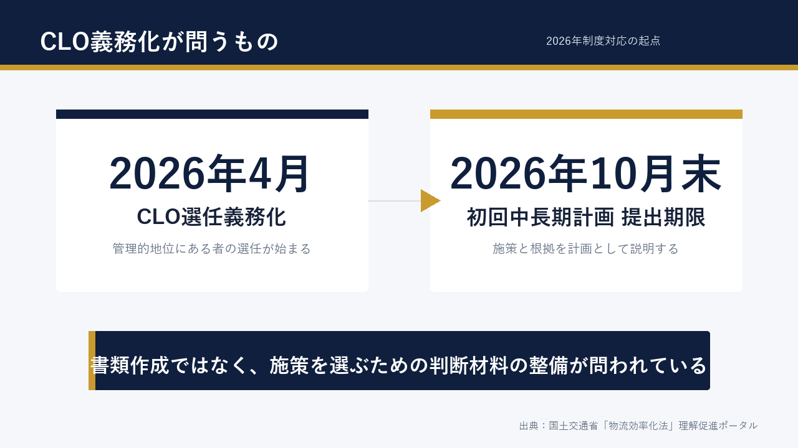
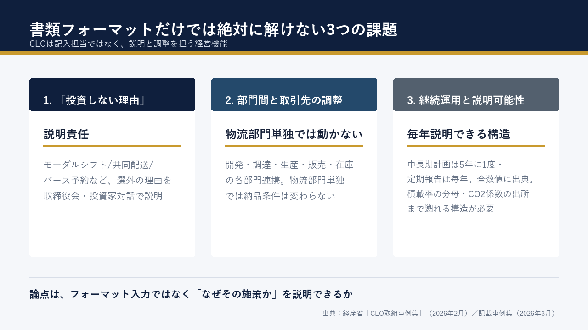
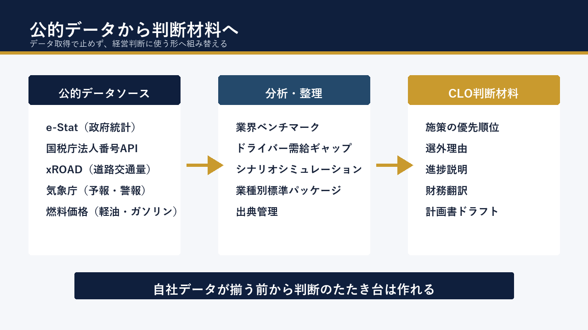
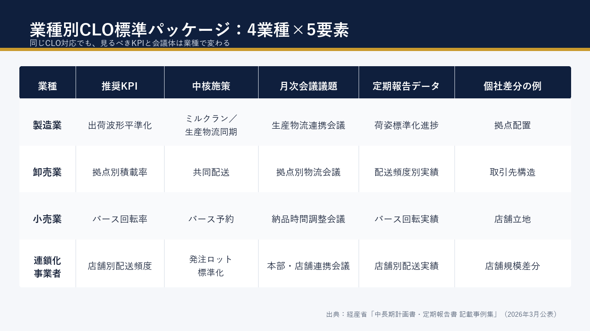
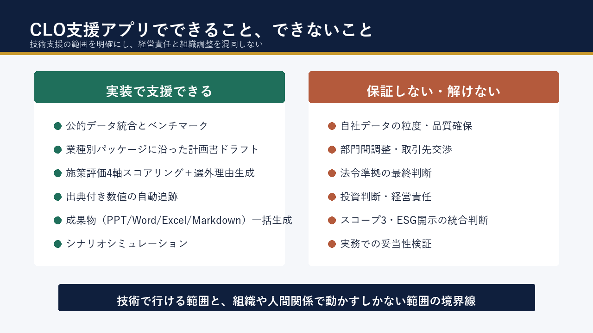

# CLO義務化を見据えて支援アプリを作った、物流システムエンジニアの調査と実装ログ

物流システム開発に関わる立場として、CLO義務化は早い段階から気になっていた。必要なのは書類作成だけではなく、施策を選ぶための判断材料ではないか。そう考えて個人開発で支援アプリを作ると決め、制度と業務を調べ、公的データで解ける部分を実装してみた記録です。

技術スタックや設計の話は別途Zennに書いた。本稿では、なぜ作ったのか、調べて何が見えたのか、公的データでどこまで届くのか、そして作って初めて分かった限界を、開発者の視点で残しておきたい。

*書類フォーマットを埋めることではなく、施策を選ぶための判断材料の整備が問われている*

---

## 1. CLO義務化を見て、支援アプリが必要だと思った

物流システムの開発に関わっていると、2026年4月の改正物流効率化法施行はずっと話題になっていた。年間9万トン以上の貨物を扱う荷主企業に、CLO（物流統括管理者）の選任が義務付けられる。中長期計画書の初回提出期限は2026年10月末。罰則も、選任未実施で100万円以下の罰金、届出懈怠で20万円以下の過料と、わざわざ条文に書き込まれている（出典：[国土交通省「物流効率化法」理解促進ポータル／CLO選任ページ](https://www.revised-logistics-act-portal.mlit.go.jp/clo/)）。

最初に違和感を覚えたのは、「CLOの仕事＝書類作成」という雰囲気が、ニュースや解説記事で先行していたことだ。実際の制度文書を読むと、CLOは「事業運営上の重要な決定に参画する管理的地位にある者」と明記されていて、求められるのは社内の部門間連携、取引先との水平・垂直連携、施策の優先順位付け、定期報告での進捗説明まで含む（出典：経済産業省／改正物流効率化法 解説パンフレット）。

そうなると、CLO担当者が本当に困るのは「**何をやれば一番効くか**」になるはずだと思った。コンサルに頼めば答えはもらえるが、高く・遅い。既存の物流DXツールは運用特化で、計画策定や施策の優先順位付けまでは踏み込まない。

ここに、支援アプリの居場所があるのではないか。施策候補を並べて、自社のデータと公的データから優先順位を出し、選ばなかった施策の理由まで添えて取締役会に上げられる――そういう「机に常駐する判断パートナー」を、個人開発で作れるところまで作ってみよう、と決めた。手元のClaude Codeと、業務で慣れたPython・Next.js・AWSの組み合わせで、どこまで届くかは分からないが、やってみないと分からない。

---

## 2. 調べてわかった、CLO業務の難所

実装を始める前に、制度と業務の両方を読み込んだ。経産省の解説パンフレット、国交省の「物流効率化法」理解促進ポータル、そして2026年2月に公表された「CLO取組事例集」と3月公表の「中長期計画書・定期報告書 記載事例集」を一通り読むと、難所は3つに絞られた。

ひとつめは、**「投資しない理由」の説明責任**だ。CLOが社内で問われるのは、採用した施策の理由だけではない。「なぜモーダルシフトではないのか」「なぜ共同配送ではないのか」「なぜバース予約から始めるのか」――選外の理由を、データと前提に基づいて取締役会・投資家対話の場で説明できないといけない。先進事例集には他社の取り組みが克明に並んでいるから、社外取締役は鋭いところを突いてくる。

ふたつめは、**部門間と取引先にまたがる調整**である。CLOは物流部門だけの仕事ではない。開発・調達・生産・販売・在庫の各部門と連携しないと、納品条件もリードタイムも変わらない。先進企業の事例を見ても、待機時間の短縮を物流部門だけで進めるのではなく、営業部門の評価軸まで踏み込んで巻き込んだ会社が成果を出している。技術で扱える部分と、組織で動かす部分の切り分けが要る。

みっつめは、**継続運用と説明可能性**だ。中長期計画は5年に1度（変更があれば随時）、定期報告は毎年。「初回を出して終わり」ではなく、毎年「進捗が出ていない理由」を語り続けないといけない。そして全数値に出典がついていないと、社内説明でも投資家対話でも持たない。「その積載率の分母は何か」「CO2削減量の係数はどこの値か」――この問いに即答できる構造を、最初の計画書のうちから仕込んでおく必要がある。

調べた限り、この3つは「書類フォーマットを埋める」だけでは絶対に解けない。だからこそ、支援アプリの設計は「データを表示する」より一歩踏み込んで、「**判断を支える**」ところまで設計しないと意味がない、と腹が決まった。

*出典：経済産業省「CLO取組事例集」（2026年2月公表）／中長期計画書・定期報告書 記載事例集（2026年3月公表）*

---

## 3. 公的データで、どこまで支援できるか

次に考えたのは、自社データに頼らず公的データだけでどこまで判断材料を作れるか、という問いだった。CLO候補企業の多くは、最初は「自社にどんなデータがあるかすら整理できていない」状態から始まる。だから自社データを前提にした設計だと、誰も使えない。

調べてみると、CLOの判断に効く公的データは意外と豊富にある。

- **e-Stat（政府統計の総合窓口）**：業種別・地域別の統計を構造化APIで取れる。物流関連の統計表は思ったより多い
- **国税庁 法人番号API**：企業の所在地・業種を引ける
- **xROAD**：道路の交通量を時系列・バウンディングボックス指定で取れる
- **気象庁**：予報・警報をJSONで取れる。配送計画への影響シミュレーションに使える
- **資源エネルギー庁の燃料価格**：軽油・ガソリンの全国平均と都道府県別

これらを組み合わせると、自社データが揃う前から「業界・地域の中で自社がどのあたりにいるか」をだいたい言える。たとえば製造業で年間出荷量の規模が分かれば、e-Statの工業統計と業種別CO2原単位、xROADの拠点周辺の混雑、燃料価格のトレンドから、おおまかなベンチマークと改善余地のレンジは推定できる。

ここで重要なのは、**「公的データだけでは判断は完結しないが、自社データの精度が上がる前から、判断のたたき台は作れる」**ということだった。先に公的データで仮の答えを出しておき、自社データが揃ったら精度を上げていく。この順番にすれば、企業は「データが揃ってから検討」ではなく、「検討しながらデータを揃える」運用に入れる。

実装を進めるうちに、これは設計上の重要な分岐点だった。「データを取ってくるツール」と「判断材料を組み立てるロジック」を分けることで、データの調達状況に依存しない判断支援が成立する。最終的にMCPツールは32本（オープンデータ系10本＋CLO支援系22本）に整理したが、設計の方針はこの分岐点で決まった。

*e-Stat・国税庁法人番号API・xROAD・気象庁・燃料価格を統合し、判断のたたき台に変える*

---

## 4. PoCで実装した、判断支援の形

実装を始めたのは2026年4月末。Claude Codeに「物流効率化法対応のCLO支援アプリを作りたい」と相談しつつ、フェーズを区切って進めた。約10日でフェーズ5.5まで到達し、現時点でMCPツール32本、REST APIエンドポイント21本、Webダッシュボード13画面、pytestのテスト845件まで揃っている。

機能の網羅的な紹介はZennに譲り、ここでは「判断支援」に直接効いた4つだけ取り上げたい。

*製造業／卸売業／小売業／連鎖化事業者で、見るべきKPI・施策・会議体・報告・データ項目はそれぞれ異なる*

- **業種別CLO標準パッケージ**：製造業・卸売業・小売業・連鎖化事業者ごとに、推奨KPI・施策・月次会議体・定期報告データ項目を整理。個社差分は別建てで管理する。業種ごとに「見るべき指標」が違うため、最初の議論の土台になる
- **施策評価エンジン**：施策候補をROI／実装可能性／法令適合度／補助金の4軸でスコアリングし、Top 3とBottom 3（選外理由付き）を出す。「投資しない理由」を組織として再現可能にするのが狙い
- **罠スコアと標準化スコア**：「効果が出ていない施策」を季節性・データ欠損・サンプル不足など6軸のセーフガードで誤検知抑止する仕組みと、業種標準への準拠度を0–100で定量化する仕組み。継続運用で「進捗が出ていない理由」を語れる構造になる
- **成果物生成**：国交省様式第3別紙の中長期計画書ドラフト（Word＋Markdown）、様式第5の定期報告書ドラフト、経営会議向けPPT、出典シート付きExcelを、ボタン1つで一括生成

特にこだわったのが、施策評価で「選外3件の理由」まで返すこと。採用候補だけ並べると、社内・社外で「なぜ別の選択肢ではないのか」を聞かれたとき答えられない。法令適合度を評価軸に組み込んでいるので、補助金や認定制度との結びつきも視野に入る。

そしてもうひとつ、全数値に出典URLを付けた。e-Statの統計表ID、告示番号、省令番号まで遡れるようにしてある。出典のない数字は、どれだけ綺麗な計画書に載っていても説明責任を果たせない。

技術構成・MCP実装の詳細・AWS構成・CI/CDまわりは、Zennで別記事にまとめている。技術スタックや設計判断に関心があれば、こちらをどうぞ。

▶ Zenn記事：[規制対応SaaSをMCP＋Next.jsで個人開発：CLOの意思決定支援PoC](https://zenn.dev/ykenkou001/articles/clo-logistics-decision-support)

---

## 5. 作って見えた、限界

10日間の個人開発で、できたこともあれば、できなかったこともある。後者を正直に書いておく。

*技術で行ける範囲と、CLO・現場が動かす範囲の境界線が、作ってみて初めてはっきり見えた*

ひとつ、**公的データだけでは判断には届かない**。仮のベンチマークは作れるが、CLOが社内で説明する「自社の真の積載率・荷待ち時間・荷役時間」を語るには、最終的には自社データが要る。それも、ロケーション別・荷種別・時間帯別の粒度でないと使い物にならない。Excel/CSVのテンプレートを用意したが、これを社内の物流現場で記入してもらうところに、別の壁がある。

ふたつ、**部門間調整・取引先交渉・経営判断は、PoCでは解けない**。施策評価エンジンは「Top 3はこれです、Bottom 3を外した理由はこれです」と返せるが、その先で「営業部に納品条件の見直しをお願いする」とか「主要取引先と共同配送のテーブルに着く」という動きは、CLOと現場の人間が動くしかない。アプリは判断材料を整えるだけで、判断そのものは代替できない。

みっつ、**法令準拠の最終保証はできない**。提出前バリデーション機能（`logi_clo_submission_validate`）で必要記載項目の整合性チェックは入れたが、「この計画書で行政手続が通るか」の最終判断はCLOと社内法務が担う。アプリはあくまで草案を整える補助で、提出は人間の責任。

そして、**実務での検証はこれから**だ。サンプル3社（製造業・卸売業・連鎖化）で動作確認はしているが、実在企業のデータ・現場感・社内オペレーションとどこまでフィットするかは、触ってもらわないと分からない。CLO候補者や物流・SCM担当者、営業・企画の方からのフィードバックを集めるのが、次のフェーズの一番大事な仕事だと思っている。

技術で行ける範囲と、組織や人間関係で動かすしかない範囲。その境界線が、作ってみて初めてはっきり見えた。これは机上で考えていたときより、ずっと現実的な発見だった。

---

## 6. それでも、作る意味

ここまで限界を書いておいて、それでも作る意味はあると思っている。

業務エンジニアとして物流現場の周辺で働いていると、CLOに関する情報は、コンサルファームの資料か、業界団体の会合か、SaaSベンダーのセミナー資料に偏っていることが多い。どれも価値はあるが、共通しているのは「外部の専門家から提供されるもの」という構図だ。

公的データと自社データを組み合わせ、出典を全て遡れる形で判断材料を組む――この発想を、社内主導で立ち上げたい企業もあるはずだ。そういう企業の物流DX担当者・SCM担当者にとって、こうしたPoCが「自分たちでも作れる」「自分たちで触れる」選択肢として意味を持てばいいと思っている。

業務で関わる領域に、個人で踏み込んで作れる。Claude Codeを併走させた今の開発環境は、AIエンジニアリングの恩恵が一番出やすい瞬間にあると感じる。

開発URLは下に置いておく。実在企業の機密データは入れないでほしいが、PoCとして触ってもらえると嬉しい。

▶ 開発URL（個人開発PoC、予告なく停止する場合あり）：https://d1zei8qivkf3cr.cloudfront.net/

▶ Zenn記事（技術構成・設計思想）：[規制対応SaaSをMCP＋Next.jsで個人開発：CLOの意思決定支援PoC](https://zenn.dev/ykenkou001/articles/clo-logistics-decision-support)

▶ 一次資料：[国土交通省 物流効率化法ポータル](https://www.revised-logistics-act-portal.mlit.go.jp/) ／ [経済産業省 物流効率化法](https://www.meti.go.jp/policy/economy/distribution/butsuryu-kouritsuka.html)

---

*ご感想・ご質問は、コメントまたはX（@ykenkou001）まで。CLOに関わる方、物流DX担当の方の現場感とのズレを、ぜひ教えてください。*
